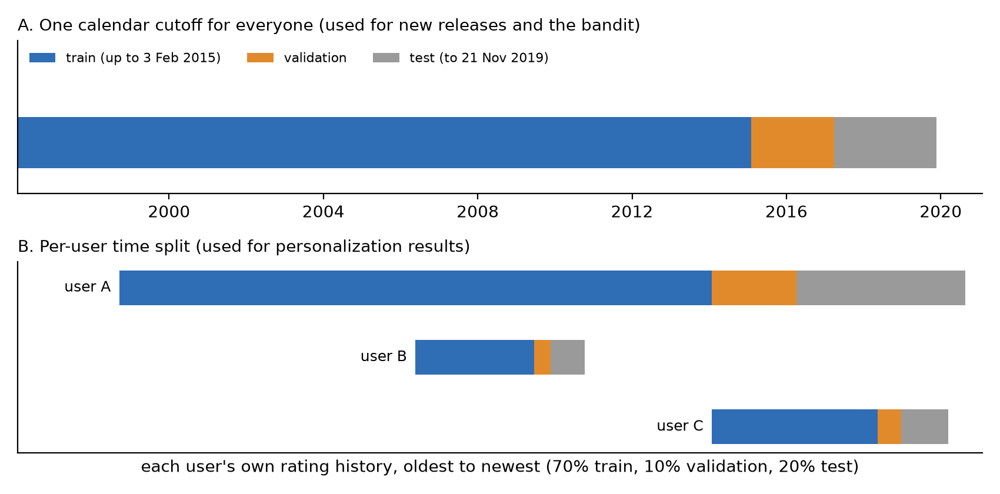

# 3. Data

## 3.1 Why MovieLens

A real OTT platform logs what people watch, for how long, on which device and at what time. None of that data is public. Netflix, Hotstar or Prime Video do not share it, and for good reason.

So I needed a public stand-in. The best known one is MovieLens, a set of movie ratings collected by the GroupLens research lab at the University of Minnesota (Harper & Konstan, 2015). I used the MovieLens 25M release. It holds 25 million ratings from about 162,000 users on about 62,000 movies, given between 1995 and 2019.

MovieLens is not a streaming log. It records ratings on a 0.5 to 5 star scale, not plays. However, it is the closest thing to viewing data that is free, large and widely used in research. That last point matters: results on MovieLens can be compared with published work.

To keep everything runnable on a laptop with 16 GB of RAM (about 9 GB usable under WSL), I worked with a random sample of 20,000 users. The sample was drawn once with a fixed seed (42), and every rating of each sampled user was kept. Table 3.1 sums it up.

**Table 3.1** *The 20,000-user sample at a glance*

| Item | Value |
|---|---|
| Users | 20,000 (every MovieLens user has at least 20 ratings) |
| Ratings | 3,101,914 |
| Movies rated | 33,392 |
| Period | January 1996 to November 2019 |
| Empty cells in the user by movie grid (sparsity) | 99.5% |
| Ratings per user | median 72, mean 155, maximum 8,913 |
| Ratings per movie | median 4; 9,997 movies have exactly one rating |
| Share of ratings that count as a "like" (4 stars or more) | 49.9% |

Two things in this table shape the rest of the project.

First, the data is extremely sparse. A typical user has rated 72 of the 33,392 movies, which is about 0.2%. Any model has to guess the other 99.8%.

Second, the catalog has a very long tail. Half of the movies have four ratings or fewer. Popular titles collect thousands. A recommender that simply pushes popular titles will look decent on paper and still be useless for most of the catalog (more on this in Chapter 5).

## 3.2 What Counts as a "Like"

The models need a yes or no signal. I treated a rating of 4 stars or more as a like and anything lower as a non-like. This splits the data almost exactly in half (49.9% likes).

The choice has a catch. A 2-star rating still means the person watched the movie. Thus, a "non-like" is not the same as "not interested". I kept this in mind throughout: every result in this report is about predicting what a user will like, not what they will click or watch.

## 3.3 Adding Movie Descriptions from TMDB

Ratings alone tell you nothing about a movie that nobody has rated yet. That is exactly the situation of a new release on an OTT platform.

To handle new titles, I added plot descriptions and release dates from The Movie Database (TMDB). MovieLens ships a link file that maps each movie to its TMDB id, so I fetched the details for all 33,319 unique ids through the TMDB API. The fetch took 36 minutes; 32,859 requests succeeded and 440 ids no longer existed on TMDB.

In the end, 98.4% of the movies have a usable description of at least 40 characters, and 32,902 have a release date. For the remaining 519 movies I fell back to the title, the genres and, where available, MovieLens tags. These descriptions later become text embeddings, which let the system match a brand-new movie to a user's taste without a single rating (Chapter 4).

This product uses the TMDB API but is not endorsed or certified by TMDB.

## 3.4 What the Data Cannot Tell Us

Before building anything, I went through the data looking for traps. I found four that matter.

**1. Ratings are not viewing.** MovieLens users rate movies on a website. Many of them rate dozens of old favorites in one sitting. In the sample, 58.2% of all ratings sit inside bursts of 30 or more ratings within 10 minutes, and 85% fall inside "sessions" of 20 or more ratings. A real viewer does not watch 30 movies in 10 minutes. So when I talk about sessions later, they are rating sprees, not viewing sessions.

**2. There is no device.** The project brief asks for device as a context feature. MovieLens does not record one. Therefore every device value in this report is SIMULATED, and I label it that way each time it appears.

**3. Time is in UTC.** Timestamps carry no time zone, so "hour of day" is UTC hour, not the user's local evening. The busiest UTC hours are 19:00 to 21:00 (about 6% of ratings each), which fits an American evening, but I cannot confirm where users live.

**4. The users are enthusiasts.** People who rate 72 movies on a research website are not a random slice of Indian OTT subscribers. The patterns here are a reasonable proxy for taste, not a measurement of any real platform's audience.

None of these are fatal. However, they set the limits of what I can claim, and Chapter 7 comes back to them.

## 3.5 Why I Did Not Split the Data at Random

To test a recommender honestly, you train it on the past and test it on the future. Splitting ratings at random would let the model peek at a user's later behavior while learning, which inflates every score.

My first attempt was a single calendar cutoff for everyone: train on ratings up to 3 February 2015, validate up to 28 March 2017, and test on the rest. It failed in an interesting way. Most users in the test period had never appeared in the training period at all: 2,610 of the 2,986 test users were new, and 90% of test ratings came from them. The reason is that many MovieLens users rate their whole history in one go and then leave. A calendar cutoff puts each of them entirely on one side of the line.

That makes a global cutoff useless for measuring personalization, because you cannot personalize for someone you have never seen. Interestingly, the same property makes it perfect for one specific question: how well can the system handle movies released after the cutoff? So I kept the calendar split for the new-release work (Chapters 4 and 5) and built a second split for everything else.

The second split works per user. I sorted each user's ratings by time, kept the last 20% for testing, the 10% before that for validation, and the oldest 70% for training. Every user now appears in all three parts, and the model is always asked to predict a user's future from their own past. Table 3.2 shows the result, and Figure 3.1 shows both splits on a timeline.

**Table 3.2** *The per-user time split*

| Part | Ratings | Used for |
|---|---|---|
| Training (oldest 70% of each user) | 2,187,571 | fitting every model |
| Validation (next 10%) | 301,690 | tuning, model choice, and training the ranker; 18,530 users have at least one like here |
| Test (newest 20%) | 612,653 | one final measurement; 19,530 users have at least one like here |

One side effect is worth stating. Under the per-user split, almost every movie in the validation and test periods already existed in training (only 0.36% of validation likes were on movies unseen in training). A per-user split does not create new releases. That is why the new-release lane and the bandit are judged on the calendar split instead.

## 3.6 Locking the Test Set

The easiest way to fool yourself in machine learning is to look at the test data while making decisions. Every peek nudges the choices toward whatever happens to work on that particular test set.

To make peeking impossible rather than just discouraged, I locked the test portion in code. Any attempt to read it raised an error, automated checks scanned all tuning code for references to it, and every script was also run once with test reads made fatal. All tuning, model selection and the ranker's training used only the training and validation parts.

The lock was opened exactly once, on 26 October 2026, by a single script with my written predictions committed beforehand. That run produced the headline results in Chapter 5. It can never run again: the script refuses to start if its own log already exists in the project history.

To be fair, this level of care is unusual for a student project. Still, I wanted the main numbers in this report to be ones I could defend in front of anyone.
