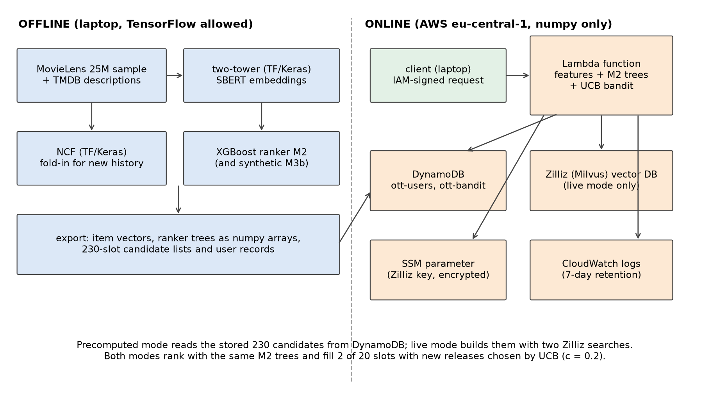
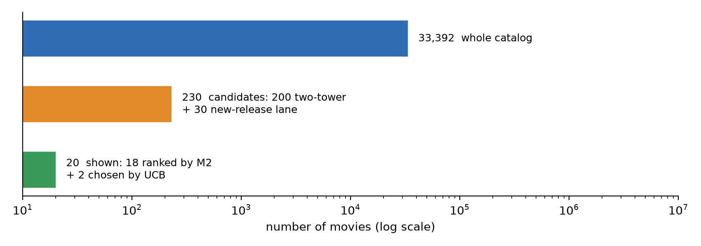

# 4. Methodology

## 4.1 The Big Picture: Two Stages, Then a Shelf for New Titles

An OTT home screen shows maybe 20 titles at a time, picked from a catalog of thousands. Scoring every title for every user with a heavy model on every visit is slow and expensive. So most large recommenders split the work in two (Covington et al., 2016).

The first stage, candidate generation, is quick and rough. It narrows 33,392 movies down to a few hundred that might interest this user. The second stage, ranking, is slower and smarter. It looks closely at those few hundred, using many more signals, and puts them in order.

My system follows the same idea, with one addition the project brief asked for: a small reserved shelf for new releases, filled by a multi-armed bandit. Figure 4.1 shows the whole system, and Figure 4.2 shows how the numbers shrink from catalog to screen.

Everything heavy happens offline on the laptop: training the models, computing embeddings and preparing candidate lists. The online part on AWS Lambda only loads precomputed numbers and does light arithmetic. This split also follows the project rule that TensorFlow runs offline only.

## 4.2 How I Measured Success

Before building models, I fixed how they would be judged. Otherwise it is too easy to pick whatever metric makes the result look good.

**The metrics.** I used two standard ones from information retrieval.

- **Recall@K** asks: of all the movies this user went on to like, what share appeared in their top K? Recall@200 judges candidate generation (did the right movies make it into the pool at all?), and Recall@20 judges what ends up on the screen.
- **NDCG@10** (Normalized Discounted Cumulative Gain) looks only at the top 10 and gives more credit for a liked movie at position 1 than at position 10 (Järvelin & Kekäläinen, 2002). It is the closest single number to "is the first row of the home screen any good?"

Both are averaged over users. I also report coverage (how many different movies a method recommends across all users), because a method that shows everyone the same blockbusters can score decently while being boring.

**End-to-end, not just "reachable".** A ranker can only reorder what candidate generation gives it. If a liked movie never made it into the 230 candidates, no ranker can find it. I report end-to-end numbers, where every liked movie counts, as the main view. A separate "reachable" view counts only likes that were inside the candidate list.

**Baselines.** Every model had to beat simple alternatives: random order, popularity (most-liked movies first) and item-based nearest neighbors, an older but strong method that recommends movies similar to the ones a user liked (Sarwar et al., 2001). A model that cannot beat these is not worth its complexity.

**Uncertainty.** Each difference between two methods is reported with a 95% interval from a paired bootstrap over users (Efron & Tibshirani, 1993). Simply put, I resampled the users many times and checked how much the difference moved. If the interval excludes zero, the difference is unlikely to be luck.

**Predictions before results.** For every module from candidate generation onward, I wrote down what I expected (direction, size and confidence) and committed it to the project history before running anything. This keeps me honest. A result I predicted carries more weight than one I explained after the fact, and the misses are part of the record (Chapter 5 lists them).

**One look at the test set.** As described in Section 3.6, the test portion was locked during all development. The final evaluation protocol was written and committed before the lock was opened. It fixed the five headline claims (P1 to P5 in Chapter 5), the exact comparisons and the rule for reading them. Only those five are findings. Everything else in the test run is secondary.

## 4.3 Stage One: Finding Candidates

### A two-tower model in TensorFlow

The main source of candidates is a two-tower model, built in TensorFlow and Keras as the project required. One tower turns each movie into a vector of 64 numbers. The other tower turns each user into a vector of the same size. A movie whose vector points in the same direction as the user's vector is a good candidate, and finding those is fast even for a large catalog.

The user tower does not need a separate ID for each user. It takes the user's last 20 liked movies, averages their vectors and passes the average through one dense layer. This has a practical benefit: when a user likes a new movie, their vector can be updated instantly with a little numpy arithmetic, without retraining anything.

Training used pairs of (user history, next liked movie), 1.09 million of them, with an in-batch softmax loss: for each user in a batch of 2,048, the model learns to score the movie they actually liked above the movies the other users liked. Because popular movies show up in many batches, they get pushed down unfairly. I corrected for this with the log-popularity adjustment from Yi et al. (2019), usually called logQ correction. It turned out to be essential: switching it off took validation Recall@200 of the ID-plus-description model from 0.635 down to 0.263, worse than plain popularity.

I tried three versions: movie ID only, movie description only, and ID plus description. On validation, the ID-only model was best for movies that already had ratings (Recall@200 0.650 against 0.584 for item-kNN). Adding the description did not help those movies and hurt slightly (by 0.015). So the main lane uses the ID-only model.

### A content lane for new movies

An ID-only model has a blind spot: a movie nobody has rated has no learned vector. It can never be recommended. On an OTT platform, that blind spot covers exactly the titles the business most wants to promote, the new releases.

To fill the gap, I turned each movie's TMDB description into a 384-number embedding with Sentence-BERT, a model that maps sentences with similar meaning to nearby vectors (Reimers & Gurevych, 2019). I used the small all-MiniLM-L6-v2 version, which runs on a laptop CPU. A user's taste profile is then the average embedding of the movies they liked, and new movies are scored by how close their description sits to that profile.

One detail made a big difference. Raw sentence embeddings share a large common direction, so every user's average profile drifts toward "generic movie". Subtracting the average embedding of all movies (centering) fixed this and multiplied validation NDCG@10 by about five. All content scores in this report use centered embeddings.

### The final candidate list

Each user gets 230 candidates:

- **200 from the two-tower model** (movies the user has not rated yet), and
- **30 from the content lane**, searched only among movies with no likes in the training data, and appended after the 200 rather than replacing any of them.

I tested several other mixes. Giving the content model a share of the 200 main slots cost accuracy on established movies, and almost all of that cost came from losing slots, not from content being bad. Appending the lane kept the main list intact while adding the new-release coverage. Finally, a candidate released after the moment of the request is removed, so the system never "recommends" a movie that did not exist yet.

## 4.4 Stage Two: Ranking the Candidates

### NCF as an extra opinion

Neural Collaborative Filtering, or NCF (He et al., 2017), learns a vector for every user and every movie from the full rating history and predicts a like with a small neural network. I built the NeuMF variant in TensorFlow (two 32-number embeddings per user and movie, and three hidden layers of 64, 32 and 16 units), trained with four sampled negative movies for each liked one.

On its own, NCF ordered the candidates worse than the two-tower model (validation NDCG@10 0.089 against 0.123). However, it looks at a different thing: long-term taste, while the two-tower model looks at recent likes. So instead of using NCF as a recommender, I used its score as one input to the ranker.

For the final test, NCF's user vectors were refreshed with each user's validation-period likes without retraining the rest of the network (a "fold-in"). Item vectors and the network itself stayed frozen.

### The XGBoost ranker

The ranker is a gradient-boosted tree model from the XGBoost library (Chen & Guestrin, 2016), trained with a ranking objective in the LambdaMART family (Burges, 2010). In plain words, it learns from pairs of candidates for the same user, one liked and one not, and adjusts itself to put the liked one higher, with extra weight on mistakes near the top of the list.

Table 4.1 lists its inputs.

**Table 4.1** *The 37 inputs of the ranker (plus 4 SIMULATED device columns in the M3 variants)*

| Group | Inputs |
|---|---|
| Two-tower | similarity score; position in the two-tower list |
| NCF | predicted like (logit); whether NCF knows this user; whether it knows this movie |
| Popularity | number of likes the movie had before the request time |
| Content | similarity between the movie's description and the user's profile; match between the movie's genres and the user's favorite genres |
| Movie | age in days at the request time; whether it came from the new-release lane; 19 genre flags |
| Time context | hour of day and day of week (UTC) |
| Session context | minutes since the last activity; whether the user is mid-session; session length so far; share of likes in the session; genre and content match with the session |

Every input is computed only from data before the request time. Automated tests check this by adding future ratings and confirming that no input changes.

The ranker was trained on the validation period. Each validation user's 230 candidates became rows, labeled 1 if the user liked the movie in the validation period. That gave 3.93 million rows with 1.82% positives. The two-tower and NCF scores in these rows came from models that never saw the validation period, so the ranker learned from honest, out-of-sample scores. For the validation results, I trained on four fifths of the users and scored the other fifth, five times over. For the test, each ranker was retrained once on all 18,530 validation users (M0 with 188 trees, M1 with 65 and M2 with 351).

### Does context help? The ablation ladder

The brief asks for context features: device, hour and session length. To measure what each one adds, I trained a ladder of rankers that differ only in their inputs:

- **M0:** no context;
- **M1:** M0 plus hour of day and day of week;
- **M2:** M1 plus the session features (the main model);
- **M3a:** M2 plus a SIMULATED device that is random and unrelated to behavior. This is a check: it should add nothing.

Comparing neighbors on the ladder shows what each group of features is worth.

Device needs special care. MovieLens has no device, so any "device effect" I show would be invented. I still wanted to prove the pipeline could learn a device effect if one existed. So I built a clearly labeled synthetic scenario: on SIMULATED mobile requests, 60% of the likes of drama movies without comedy were removed from the training labels. A model with device as an input (**M3b**) should pick this up, and the same model with the device values shuffled between users should not. **This is a synthetic device effect, a pipeline demonstration, not a finding.**

## 4.5 New Releases and the Bandit

### The problem

A brand-new title has no ratings, so the ranker has little to go on and tends to bury it. In my validation runs, new-release candidates never reached the ranker's top 20. Yet a platform pays for new content and needs people to see it.

The standard answer is to reserve a couple of slots for new titles and let a multi-armed bandit choose what goes there. A bandit treats each new title as a slot machine with an unknown payout (the like rate). It has to balance exploring titles it knows little about with exploiting titles that already look good.

I used UCB, short for Upper Confidence Bound (Auer et al., 2002). For each title it adds a bonus to the observed like rate: the fewer times a title has been shown, the bigger the bonus. Titles that are either good or still uncertain get shown. The size of the bonus is set by a constant, c. I compared UCB with the textbook constant (UCB1), a tuned constant, UCB1-Tuned, Thompson sampling (Thompson, 1933), epsilon-greedy, plain greedy and random.

### Why a simulation

Testing a bandit properly needs live users: you show something and see what they do. Offline "replay" methods exist, but they need logs where the shown item was chosen at random (Li et al., 2010). MovieLens ratings are people's own choices, not random exposures. So I evaluated the bandit with a simulation, and every bandit number in this report carries the label **SIMULATION, NOT AN A/B TEST**.

The simulation was built from real data where possible:

- **Arms:** movies released (by TMDB date) shortly before or during the evaluation window and never rated before it.
- **Hidden like rates:** each movie's real ratings in the window, pulled toward the overall like rate (equivalent to five extra average ratings) so that thinly rated movies do not look extreme. A fresh draw is made for each of 30 repeated runs.
- **Requests:** the real session starts in the window (a new session begins after 30 minutes of silence).
- **Rules:** 2 reserved slots per request; a movie stays on the new-release shelf for 365 days after release; a "like" is drawn from the hidden rate. The reward means "liked, given that the user rated it" and ignores whether they would have clicked at all.

The bandit was judged on the calendar split from Section 3.5, because that is where real new releases exist.

### Tuning the constant without cheating

The textbook UCB1 constant explored far too much with hundreds of titles. So I tuned c on the first half of the validation request stream and evaluated on the second half, with different random seeds. The chosen value for the main set (629 titles with at least five ratings in the validation window) was c = 0.2, and the second half confirmed it. That value was then fixed in the test protocol before the test was opened.

### What the shelf costs

Reserving 2 of 20 slots means 2 fewer ranked titles on screen. I measured this cost on the main ranking too, so the business trade-off is visible (Chapter 6).

## 4.6 Putting It Online

The brief asks for serving on AWS Lambda with DynamoDB. Lambda runs code only when a request arrives, with no server to manage, and charges by the millisecond. DynamoDB is a key-value database that answers single lookups in a few milliseconds. Both have free tiers that cover a student project.

### What runs where

The Lambda function has a hard size limit: 50 MiB for a zipped upload. TensorFlow and XGBoost do not fit. Even the small CPU build of XGBoost pulls in scipy, which takes the package to 58 MB before adding any data. So I rewrote the scoring parts in plain numpy:

- the two-tower user vector and NCF scoring (a few matrix multiplications), and
- the XGBoost ranker, as a small tree evaluator that reads the trained trees. It matched XGBoost's own predictions on 200,000 real feature rows to within 0.0001 and gave the same top-20 order.

The final package is 49.4 MiB. It contains the code, numpy and the model data, with the content vectors stored at half precision to fit (in a check on 1,500 sampled users, this changed the top 18 for only 2 of them).

### A request, step by step

1. The client sends a signed request with a user id. The function URL accepts only requests signed with valid AWS credentials, so it is not open to the public.
2. The function reads the user's record from DynamoDB: the 230 stored candidates, the user's vectors, their rated movies and their latest session.
3. It computes the 37 inputs and scores the candidates with the M2 trees.
4. It fills 18 slots with the best-ranked titles and 2 slots with new releases chosen by UCB (c = 0.2), using shared counts kept in a second DynamoDB table.
5. It returns 20 titles with timing for each step.

In **precomputed mode**, step 2 uses the stored candidate list. In **live mode**, the function builds the candidates fresh with two searches in a Zilliz Cloud vector database, a hosted version of the open-source Milvus (Wang et al., 2021). This is what a platform would use when the catalog changes often. I loaded the two-tower movie vectors and the content vectors into Zilliz's free cluster in Frankfurt, which uses its own automatic index type. Section 5.5 measures how close live results come to the exact precomputed ones.

### Keeping it safe and cheap

- All resources live in Frankfurt (eu-central-1), next to the Zilliz cluster, to keep live searches short.
- The deploying user's permissions are limited to resources whose names start with "ott-", in two regions, with explicit blocks on costly services such as EC2.
- The Zilliz key is stored encrypted in AWS Systems Manager, never in the code or in environment variables. No script prints keys, account numbers or addresses, and automated tests check this.
- Logs are kept for 7 days. Tables are billed per request, not reserved in advance.
- Everything was deleted after the measurements, and a teardown check confirmed nothing was left.

## 4.7 Tools

The models were built in Python 3.12 with TensorFlow and Keras (two-tower, NCF), sentence-transformers (SBERT), XGBoost (ranker), numpy and pandas. The cloud parts used boto3 (AWS) and pymilvus (Zilliz). Every analysis step is a committed script with fixed random seeds, and more than 350 automated tests cover the code. I used Claude Code, an AI coding assistant, throughout the build. Appendix H describes what it did and what I did.
