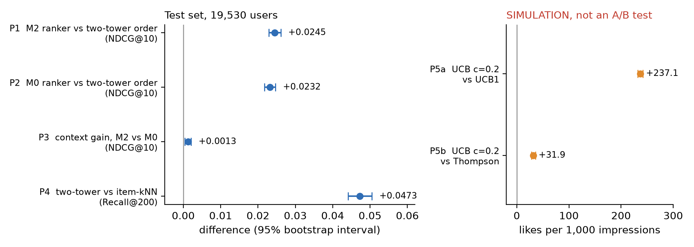
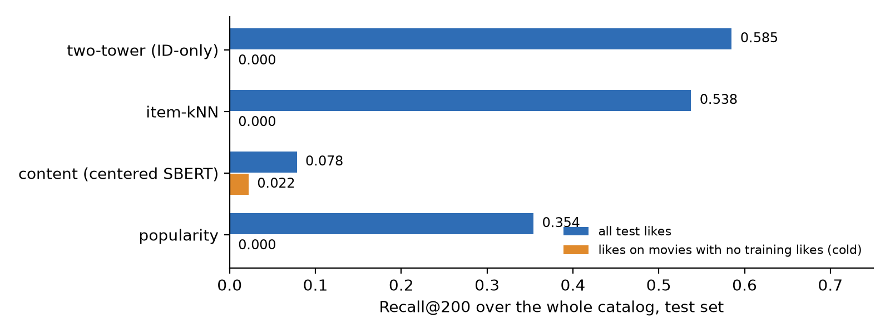
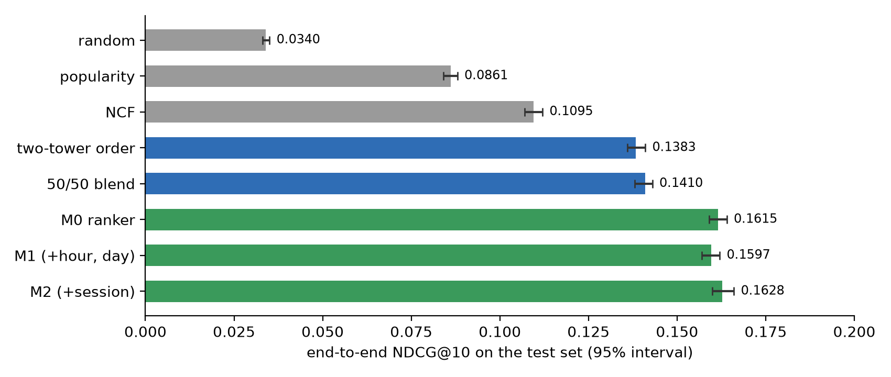
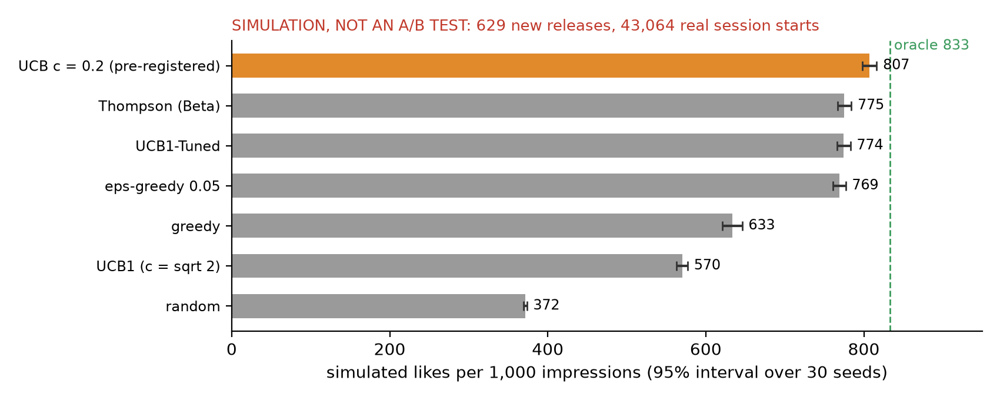
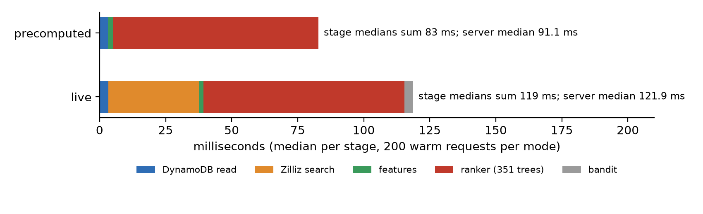
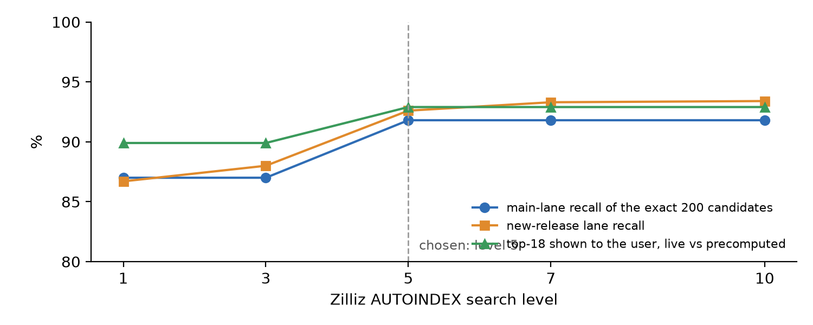

# 5. Results

## 5.1 The Five Headline Results

These are the only findings in this report. Each one was written down, with a predicted range, before the test set was opened, and each comes from that single test run on 19,530 users (Section 3.6). Users in the test period liked 14.7 movies each on average.

**Table 5.1** *Headline results on the test set, with the predictions committed beforehand*

| | Claim | Predicted | Measured (95% interval) | Verdict |
|---|---|---|---|---|
| P1 | M2 ranker beats the two-tower's own order (NDCG@10) | +0.006 to +0.022 | **+0.0245** (+0.0229 to +0.0261) | right direction, bigger than predicted |
| P2 | M0 ranker (no context) beats the two-tower's own order (NDCG@10) | +0.005 to +0.020 | **+0.0232** (+0.0217 to +0.0247) | right direction, bigger than predicted |
| P3 | Context adds little: M2 minus M0 (NDCG@10) | -0.002 to +0.004 | **+0.0013** (+0.0004 to +0.0021) | inside the range |
| P4 | Two-tower retrieves more than item-kNN (Recall@200) | +0.03 to +0.07 | **+0.0473** (+0.0441 to +0.0505) | inside the range |
| P5a | UCB with c = 0.2 beats textbook UCB1 (likes per 1,000 impressions, SIMULATION) | more than +100 | **+237.1** (+232.2 to +242.0) | inside the range |
| P5b | UCB with c = 0.2 against Thompson sampling (SIMULATION) | within plus or minus 30 | **+31.9** (+27.9 to +35.9) | just outside the range |

In plain words:

- **The learned ranker works.** M2 lifts NDCG@10 from 0.1383 to 0.1628, a relative gain of about 18%. Every one of its inputs was already available to the two-tower model or to NCF, so the gain comes from combining them well.
- **Context adds very little.** The difference between the ranker with and without context is real (the interval excludes zero) but tiny: 0.8% of M0's score.
- **The two-tower model is the better retriever.** It finds 58.5% of a user's future likes in its top 200, against 53.8% for item-kNN, a relative gain of about 9%.
- **A tuned UCB earns far more than the textbook version** in the simulation (807 against 570 simulated likes per 1,000 impressions, about 42% more), and slightly more than Thompson sampling (about 4% more).

Every predicted direction was right. Three of the six size ranges held (P3, P4, P5a). I underestimated the ranker's gain (P1, P2), and the UCB margin over Thompson landed just outside my band (P5b). I report these as they came out.

The sections below give the supporting evidence. Unlike Table 5.1, those numbers are secondary: some intervals exclude zero by chance when many comparisons are made at once, so I read them as context, not as findings.

## 5.2 Candidate Generation

Figure 5.2 compares four ways of building the candidate pool over the whole catalog of 33,392 movies.

The two-tower model leads (Recall@200 of 0.585), followed by item-kNN (0.538) and popularity (0.354). The content model on its own is weak overall (0.078), which is expected: a description tells you less about taste than thousands of other people's ratings do.

However, the orange bars show where content earns its place. For likes on movies that had no ratings in training, every collaborative method scores exactly zero, by construction. Content is the only method that finds any of them (0.022). This is the reason for the separate new-release lane.

The lane's value shows best on the calendar split, where real new releases exist. On validation (360 to 420 users, so the numbers are rough), appending the 30-movie content lane to the 200 two-tower candidates found 10.8% of users' likes on brand-new titles, against 0% for the two-tower model alone, and it did not reduce the hit rate on established titles at all. That 10.8% is partly flattered by the way "new" was defined, since the lane searches the same pool. Under a second definition that the lane was not built around (movies first rated after the cutoff), the figure was 9.5%, which I treat as the safer estimate.

## 5.3 Ranking

Figure 5.3 shows how different methods order the same 230 candidates on the test set.

Three things stand out.

First, simple ordering rules hit a ceiling. The two-tower model's own order (0.1383) and a fixed 50/50 blend of two-tower and NCF (0.1410) are close. The trained ranker beats the blend by 0.0218, about 15%. A ranker learns how much to trust each signal for each kind of movie, and a fixed blend cannot.

Second, NCF on its own is weaker than the two-tower order (0.1095 against 0.1383), yet it helps inside the ranker. Its long-term view complements the two-tower model's focus on recent likes. Refreshing NCF's user vectors with the validation-period likes (the fold-in) was worth +0.0027 NDCG@10 to the ranker over stale vectors.

Third, the ranker improves what the user actually sees. Recall@20, the share of future likes that make it onto a 20-title screen, rises from 0.188 with the two-tower order to 0.210 with M2, a relative gain of about 12%.

## 5.4 Does Context Help?

This was the question I was most curious about, because the brief puts context at the center. The honest answer for this data is: barely.

**Table 5.2** *The context ladder on the test set (end-to-end NDCG@10; secondary except P3)*

| Model | Inputs | NDCG@10 | Change |
|---|---|---|---|
| M0 | no context | 0.1615 | |
| M1 | + hour, day | 0.1597 | -0.0019 (-0.0026 to -0.0012) |
| M2 | + session | 0.1628 | +0.0032 against M1 (+0.0022 to +0.0041) |
| M2 against M0 | total context (P3) | | **+0.0013** (+0.0004 to +0.0021) |

Interestingly, hour and day made the test result slightly worse, while the session features helped. On validation, hour and day were also null in the more careful training run, and the session step was small but positive (+0.0018). The pattern is consistent: time of day carries almost no signal here, and session state carries a little.

This makes sense given the data. MovieLens timestamps are UTC, so "evening" is not anyone's real evening. Also, most "sessions" are rating sprees in which people log old favorites, not viewing sessions (Section 3.4). On a real platform with local time and real viewing sessions, I would expect context to matter more. I cannot show that with this data.

Device was tested two ways, both with SIMULATED values:

- A random device with no link to behavior (M3a) added nothing on validation (+0.0001, interval -0.0010 to +0.0013), as it should.
- In the synthetic scenario (**Synthetic device effect, pipeline demonstration, not a finding**), M3b learned the planted rule: +0.0029 on validation (+0.0018 to +0.0041). When the device values were shuffled between users, the gain vanished (+0.0006, interval includes zero). So the pipeline can pick up a device effect when one exists.

The synthetic scenario also says something useful about scale. A fairly strong planted effect (60% of drama-without-comedy likes removed for the 35% of users on SIMULATED mobile) moved NDCG@10 by only about 0.003. A real device effect smaller than that would be hard to see in this kind of offline test.

## 5.5 New Releases and the Bandit

*All numbers in this section come from a SIMULATION, NOT AN A/B TEST.*

The bandit simulation on the test window used 2,830 new releases and 43,064 real session starts between March 2017 and November 2019. Figure 5.4 shows the main set: the 761 titles with at least five ratings in the test window (the same rule gave 629 titles in the validation window, where the constant was tuned).

The best possible strategy, one that already knows every title's true like rate, earns 833 likes per 1,000 impressions. Showing titles at random earns 372. Measured against that gap, UCB with c = 0.2 captured 94% of the possible gain, Thompson sampling 87% and textbook UCB1 only 43%. Plain greedy (always show the current best) got stuck early on titles that only looked good.

The same ordering held on the smaller set of 266 titles with at least 20 ratings and on the full set of 2,830 titles with at least one rating. On the larger set, UCB1 did even worse (484, barely above random at 386), because its bonus keeps it exploring hundreds of thin titles.

There is a trade-off hidden in these numbers. UCB with a small constant concentrates impressions on a few titles: its exposure Gini coefficient is 0.98, against 0.90 for Thompson sampling. Every title did get shown at least once, but most impressions went to the leaders. For a platform that also cares about giving each new release a fair chance, Thompson sampling is a reasonable alternative that earns a little less (Chapter 6).

**The cost of the shelf.** Reserving the last 2 of 20 slots for new releases left NDCG@10 unchanged (the top 10 is untouched) and lowered Recall@20 by 0.0138 (about 6.6% of M2's 0.2100). Putting the two slots inside the top 10 instead cost 0.0175 NDCG@10. The two sides of this trade-off are measured on different scales (simulated likes on new titles against real hits on established ones), so I do not net them into one number.

## 5.6 Serving in Practice

The whole system was deployed on AWS in Frankfurt and called from my laptop in India. It ran without errors: 400 timed requests, 10 forced cold starts and the demo, with zero failures and zero live-mode fallbacks. Like the test set, the latency study had its predictions committed before it ran.

**Table 5.3** *Measured latency, 200 warm requests per mode (server time is measured inside the function)*

| | Precomputed mode | Live mode |
|---|---|---|
| Server time, median (95% interval) | 91.1 ms (85.9 to 96.4) | 121.9 ms (121.2 to 123.6) |
| Server time, 95th / 99th percentile | 118.5 / 121.7 ms | 144.2 / 163.9 ms |
| End to end from the laptop, median | 338 ms | 367 ms |
| Cold start (5 per mode), median | 0.6 s start-up plus 1.5 s for the first request | 0.6 s start-up plus 1.8 s for the first request |
| Peak memory | 204 MB of 1,024 | 220 MB of 1,024 |

The biggest surprise was where the time goes. I expected the database and network calls to dominate. Instead, the ranker takes 78 of the 91 ms (85%). Scoring 230 candidates with 351 trees in numpy takes about 11 ms on my laptop, but a Lambda function with 1,024 MB gets well under one full processor core. The live searches add only about 31 ms at the median, and the DynamoDB reads about 3 ms.

The predictions held for 5 of 8 quantities. The three misses:

- I predicted 8 to 30 ms for a warm precomputed request and measured 91 ms. I scaled the laptop timing too optimistically.
- I predicted a cold start of 800 to 3,000 ms and measured 572 ms. However, this was the wrong number to predict. The function loads its data on the first request, not during start-up, so the real wait for a user hitting a cold function is about 2.1 to 2.4 seconds.
- The laptop's network connection setup to Frankfurt took 492 ms, slower than the 100 to 400 ms I expected.

**Live search quality.** Zilliz's index is approximate: it trades a little accuracy for speed. With its default setting, live search returned 87% of the exact candidates. Raising the search level helped up to level 5, and then stopped improving (Figure 5.6). I chose level 5. At that level, live mode shares about 93% of the top 18 titles with precomputed mode for the same user. Zilliz's documentation suggests that higher levels can reach 99% (Zilliz, n.d.); on the free cluster I could not get past 92%, and I could not find out why.

One engineering fix is worth mentioning. My first live-search client opened a new secure connection for every search. Reusing one connection cut the search time measured from my laptop from about 960 ms to about 241 ms.

**The demo.** A short demo page called the deployed function for real users (Appendix F). For one sampled user, moving the request from mid-session to after a three-day break changed 2 of the 18 ranked titles. In the synthetic device scenario, M3b showed on average 5.9 drama-without-comedy titles in the top 18 on a SIMULATED tv and 3.5 on a SIMULATED mobile, across 40 users, while M2 (which ignores device) showed 6.7. That is the planted effect, visible end to end, and it says nothing about real viewers.

## 5.7 Where I Was Wrong

I want to close this chapter with my misses, because they taught me as much as the hits.

- **The ranker gained more than I predicted** (P1, P2). I expected the two-tower order to be harder to beat.
- **Textbook UCB1 looked like a bad choice at first.** In my first bandit run, plain UCB1 lost to epsilon-greedy and Thompson sampling, and I almost concluded that UCB was the wrong tool. Tuning the constant reversed that verdict.
- **I expected context to matter more.** It did not, on this data.
- **I expected the database to be the slow part of serving.** The ranker was.
- **I assumed a "read-only" Zilliz key would be read-only.** Two keys that I created as read-only could still write on the free cluster (Chapter 7).
