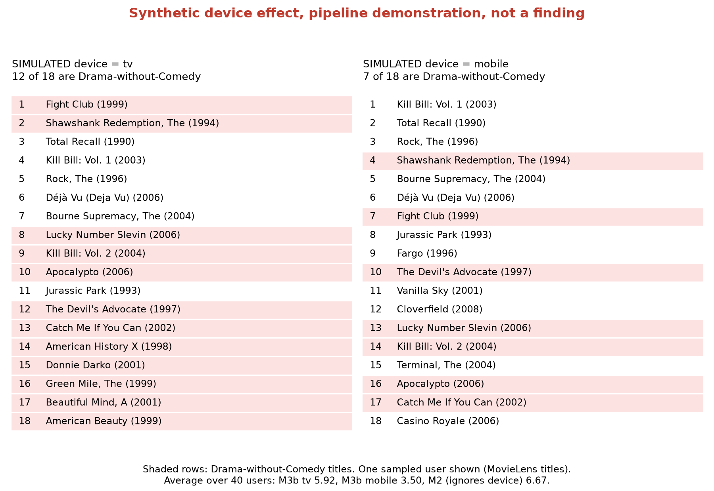

# Appendix F. The Demo

After the latency study, a script called the deployed function for real users and wrote a demo page (`reports/module9_demo.html`). Every list on the page came from a live request to the function in Frankfurt. The page has four sections:

- **A.** The real M2 ranker for one user, mid-session and after a three-day break (2 of 18 titles changed).
- **B.** The synthetic device scenario, the same user with a SIMULATED tv and a SIMULATED mobile (Figure F.1).
- **C.** Live vector search against precomputed candidates for the same user (16 of 18 titles shared).
- **D.** The new-release slots under simulated feedback (200 requests, 145 new-release impressions, 40% simulated likes; SIMULATION, NOT AN A/B TEST).

Every section carries its label on the page itself, so a screenshot cannot lose it.

